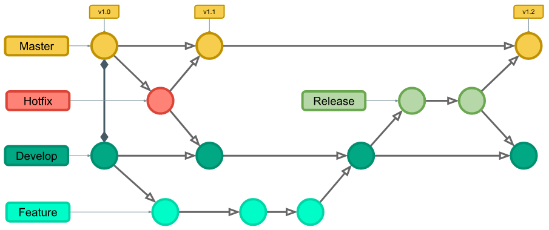

# ai_operations_hs26

Repository für die Assignments im Modul «AI Operations» (Business AI, FHNW).

## Branches

Ich arbeite wie in der Praxis üblich mit zwei festen Branches:

- `main` – stabiler, abgabebereiter Stand
- `dev` – Entwicklung und Tests

Ab Auftrag 1.2 (Cloud) erweitere ich diesen Workflow um kurzlebige Feature-Branches und orientiere mich dabei an folgendem Modell:

- `autocomplete` – Feature-Branch für den CSV-/Excel-Export der Berechnungen (in `dev` gemerged)

So festige ich gleichzeitig meine Git-Kenntnisse im Terminal.

## Auftrag 1 – DevOps

Arbeitszeit- und Lohnrechner für mehrere Arbeitgeber, bereitgestellt als REST-API mit FastAPI – lokal sowie in der Cloud auf render.com.

- Webseite: https://ai-operations-hs26.onrender.com
- Details: [`arbeitsstunden_info/README.md`](./arbeitsstunden_info/README.md)

## Hilfsmittelverzeichnis

| Hilfsmittel | Verwendung |
|---|---|
| Claude | Mentoring beim eigenständigen Programmieren: Code-Reviews, Fehleranalyse, Diskussion von Design-Entscheidungen |
| Claude | Generierung der Web-Oberfläche nach eigenen Vorgaben («Vibe Coding») |
| Claude | Erstellung der README-Dokumentation auf Basis eigener Notizen über alle Aufträge |

Die betroffenen Dateien pro Auftrag sind im jeweiligen Unter-README aufgeführt.