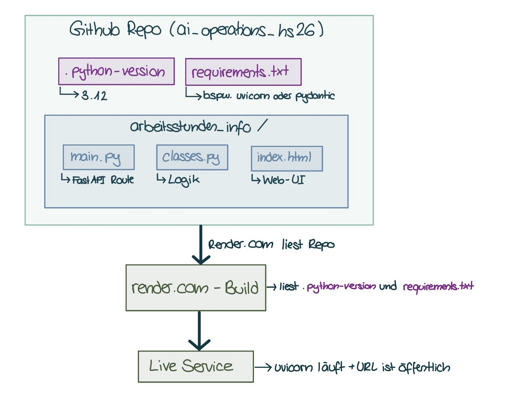

# Arbeitszeit- & Lohnrechner

Eine kleine REST-API, die Arbeitszeit und Lohn für mehrere Arbeitgeber berechnet inklusive Wochenendzuschlag, optionalem Monats-Soll-Tracking und optionaler Berechnung der Sozialabzüge (AHV/IV/EO, ALV).

## Features

- Berechnung der Netto-Arbeitszeit inkl. Pausenabzug (auch über Mitternacht hinweg)
- Automatischer Wochenendzuschlag (25%), abgeleitet aus dem Datum
- Optionales Tracking: verbleibende Stunden bis zum Monats-Soll
- Optionale Berechnung von Brutto- zu Netto-Lohn (AHV/IV/EO, ALV)
- Web-Oberfläche zur Eingabe, inkl. JSON-Ansicht
- Export der Berechnung als neue Zeile in eine bestehende oder neue CSV-/Excel-Datei, direkt im Browse

### Kurzes Erklärvideo

Umsetzung Lokal:
<video controls src="../medien/Stundenzettel_AnnaNikitaMueller.mp4" title="Title"></video>

Umsetzung Cloud:
<video controls src="../medien/Stundenzettel_cloud_AnnaNikitaMueller.mp4" title="Title"></video>

## Setup

```bash
python -m venv .venv
.\.venv\Scripts\activate      # Windows PowerShell
# source .venv/bin/activate   # macOS/Linux

pip install -r requirements.txt
```

## Starten

Im Projekt-Root ausführen:
```bash
uvicorn arbeitsstunden_info.main:app --reload
```

- Web-UI: [http://127.0.0.1:8000/](http://127.0.0.1:8000/)
- Interaktive API-Doku (Swagger): [http://127.0.0.1:8000/docs](http://127.0.0.1:8000/docs)

**Input-Felder:**

| Feld | Typ | Pflicht | Beschreibung |
|---|---|---|---|
| `arbeitgeber` | string | ja | Name des Arbeitgebers (mind. 3 Zeichen) |
| `startzeit` | datetime (ISO 8601) | ja | Beginn der Schicht |
| `endzeit` | datetime (ISO 8601) | ja | Ende der Schicht (kann am Folgetag liegen, z. B. Nachtschicht) |
| `pausenzeit_total_minuten` | int | ja | Pausendauer in Minuten (≥ 0) |
| `stundenlohn_chf` | float | ja | Stundenlohn in CHF (> 0) |
| `monat_soll_stunden` | float | nein | Monats-Soll in Stunden (> 0); erfordert `bereits_geleistete_stunden` |
| `bereits_geleistete_stunden` | float | nein | Bereits geleistete Stunden diesen Monat (≥ 0) |
| `sozialabzuege_berechnen` | bool | nein (Default `false`) | Ob AHV/IV/EO- und ALV-Abzüge berechnet werden sollen |

**Output-Felder:**

| Feld | Typ | Beschreibung |
|---|---|---|
| `arbeitgeber` | string | wie im Input |
| `datum` | date | Datum der Schicht (aus `startzeit` abgeleitet) |
| `arbeitszeit_stunden` | float | Netto-Arbeitszeit in Stunden |
| `verbleibende_stunden_monat` | float \| null | Restliche Stunden bis Monats-Soll; `null`, wenn kein Soll angegeben |
| `brutto_verdienst_chf` | float | Verdienst inkl. Wochenendzuschlag, vor Abzügen |
| `ahv_iv_eo_abzug` | float \| null | AHV/IV/EO-Abzug in CHF; `null`, wenn nicht berechnet |
| `alv_abzug` | float \| null | ALV-Abzug in CHF; `null`, wenn nicht berechnet |
| `netto_verdienst_chf` | float \| null | Verdienst nach Abzügen; `null`, wenn nicht berechnet |

## Design-Entscheidungen

- **Nachtschicht:** `startzeit`/`endzeit` sind volle `datetime`-Werte (nicht nur Uhrzeit). Dadurch funktioniert die Berechnung automatisch korrekt über Mitternacht hinweg, ganz ohne Sonderfall-Logik.
- **Wochenendzuschlag:** wird aus dem Wochentag von `startzeit` abgeleitet, kein separates Ja/Nein-Feld nötig.
- **Zuschlagshöhe:** fixer Prozentsatz als Konstante, nicht pro Request einstellbar.
- **Sozialabzüge:** nur AHV/IV/EO und ALV, da diese landesweit einheitliche Prozentsätze haben. NBU (branchen-/stundenabhängig) und BVG (altersabhängig, jahresbasiert) wurden bewusst **nicht** implementiert, da sie sich nicht sinnvoll auf eine einzelne Schicht herunterrechnen lassen.
- **Rundung:** durchgehend 2 Nachkommastellen für Stunden und CHF.
- **Zustandslosigkeit:** Die API speichert nichts zwischen Anfragen – `bereits_geleistete_stunden` muss bei jedem Aufruf mitgegeben werden. Bewusste Design-Entscheidung, u. a. weil render.com im Free Tier keinen persistenten Speicher bietet. Aus demselben Grund läuft auch der Datei-Export vollständig im Browser: Die Datei bleibt bei der Benutzerin oder dem Benutzer, der Server muss nichts speichern.

## Auftrag 1.2 – Cloud

Für Auftrag 1.2 wurde der lokal entwickelte Rechner um eine Exportfunktion erweitert und über render.com in der Cloud bereitgestellt.

**Exportfunktion:** Über die Web-Oberfläche kann optional eine bestehende CSV- oder Excel-Datei ausgewählt werden. Die aktuelle Berechnung (Eingabe- und Ergebniswerte) wird als neue Zeile ergänzt, und die aktualisierte Datei steht direkt zum Download bereit. Wird keine Datei ausgewählt, wird eine neue CSV-Datei erstellt. Die Funktion ist als JavaScript in `index.html` umgesetzt und benötigt keinen zusätzlichen API-Endpunkt. Der Upload ist bewusst optional, da der Rechner auch ohne ihn vollständig nutzbar ist.



**Deployment:** Der render.com-Account ist mit dem GitHub-Repository verknüpft und deployt den Branch `main`.

| Einstellung | Wert |
|---|---|
| Build Command | `pip install -r requirements.txt` |
| Start Command | `uvicorn arbeitsstunden_info.main:app --host 0.0.0.0 --port $PORT` |
| Python-Version | 3.12, festgelegt über `.python-version` im Projekt-Root |

**Webseite:** https://ai-operations-hs26.onrender.com
Hinweis: Im Free Tier schläft der Dienst nach längerer Inaktivität ein. Der erste Aufruf kann deshalb bis zu einer Minute dauern.

## Ideen für Erweiterungen

- Batch-Skript zum automatisierten Ausfüllen mehrerer Schichten aus einer CSV (Konzept besprochen, noch nicht Teil dieses Repos)
- Persistente Historie pro Arbeitgeber/Monat
- Persistente Historie pro Arbeitgeber und Monat
- Import mehrerer Schichten auf einmal, falls sich dafür ein Bedarf zeigt

## Hilfsmittelverzeichnis
| Hilfsmittel | Verwendung | Betroffene Stellen |
|---|---|---|
| Claude | Schritt-für-Schritt-Mentoring beim eigenständigen Programmieren: Code-Reviews, Fehleranalyse, Diskussion von Design-Entscheidungen | Business-Logik in `classes.py`, API-Anbindung in `main.py` |
| Claude | Vollständige Generierung der Web-Oberfläche HTML nach eigenen Vorgaben ("Vibe Coding") | `index.html` inkl. Exportfunktion |
| Claude | Erstellung der README-Dokumentation basierend auf eigenen Notizen und dem Projektverlauf | `README.md` |

## Anhang 1: Meine Learnings aus Auftrag 1.1 (lokal)

Das Tool ist schrittweise gewachsen: von simplem Input (Arbeitgeber, Start/Ende) über Pausenzeit und Monats-Soll bis zu optionalen Sozialabzügen (AHV/IV/EO, ALV) – relevant gerade für Studierende, die ihre AHV-Beitragspflicht im Blick behalten müssen. Der Wochenendzuschlag wird bewusst aus dem Datum abgeleitet statt manuell abgefragt, damit das Tool weniger Eingaben braucht und «mitdenkt».

**Wichtigste Erkenntnisse:**
- Pydantic-Modelle sind ein statischer Bauplan – Felder lassen sich nicht per `if` bedingt definieren; für optionale Werte braucht es `Optional` aus `typing`.
- `timedelta` (Zeitspanne) und `datetime` (Zeitpunkt) sind unterschiedliche Konzepte – entscheidend für korrekte Berechnungen über Mitternacht hinweg.
- Formatierung (z. B. Datumsdarstellung) gehört in die Anzeige, nicht ins Datenmodell.

## Anhang 2: Meine Learnings aus Auftrag 1.2 (Cloud)

Ich wollte vor allem, dass sich das Ergebnis direkt weiterverwenden lässt, statt den JSON-Output manuell in Excel zu kopieren.

Mein erster Ansatz war ein separater Endpunkt (`/csv-ausfuellen`) für den Batch-Import mehrerer Zeilen aus einer CSV- oder Excel-Datei – bewusst getrennt vom Haupt-Endpunkt, damit ein Fehler beim Einlesen nicht die normale Berechnung beeinträchtigt. Dieser Teil war fachlich anspruchsvoll, und ich war hier stärker auf Claude angewiesen als bei der übrigen Logik.

Im Nachhinein zeigte sich, dass die Batch-Verarbeitung für meinen eigentlichen Bedarf gar nicht nötig war. Für den typischen Fall – eine einzelne Berechnung zum bestehenden Verlauf hinzufügen – reichte eine deutlich einfachere Lösung direkt im Browser, ganz ohne zusätzlichen Endpunkt. Ich habe den Endpunkt deshalb wieder entfernt. Die wichtigste Erkenntnis daraus: zuerst den tatsächlichen Anwendungsfall klären, dann die Lösung wählen – nicht umgekehrt.

Beim Deployment gab es zudem eine Stolperfalle: Der erste Build schlug fehl, weil ich die Python-Version nicht festgelegt hatte und render.com standardmässig eine neuere Version wählte, für die eines meiner Pakete nicht kompilierbar war. Eine `.python-version`-Datei im Projekt-Root mit derselben Version wie meine lokale Umgebung (3.12) hat das Problem gelöst. Seither achte ich darauf, dass lokale und Cloud-Umgebung möglichst identisch sind.

## Anhang 2: Deployment
TODO:
- [x]Lokal Auftrag erledigen
- [x]README Dokumentation erstellen
- [x]Code noch kommentieren
- [x]automatisiertes Ausfüllen des Stundenzettels
- [x]README Abschnitt bei Auftrag 1.2 verbessern
- [x]Cloud Auftrag erledigen
